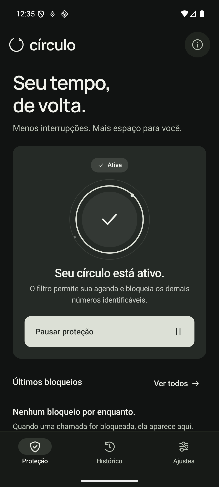
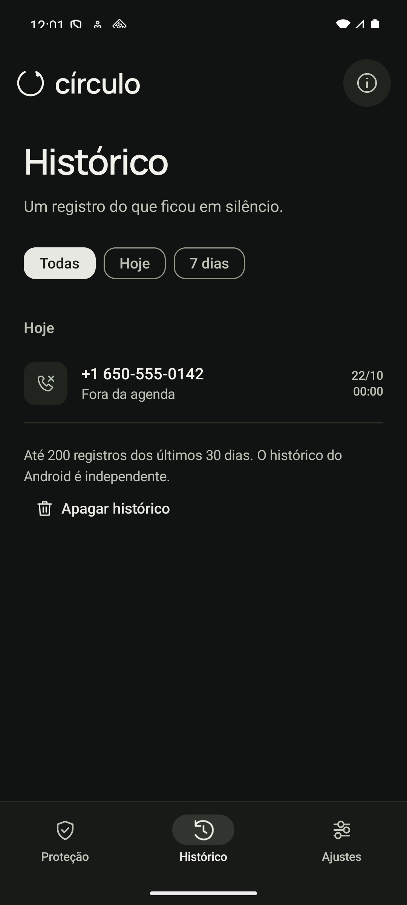
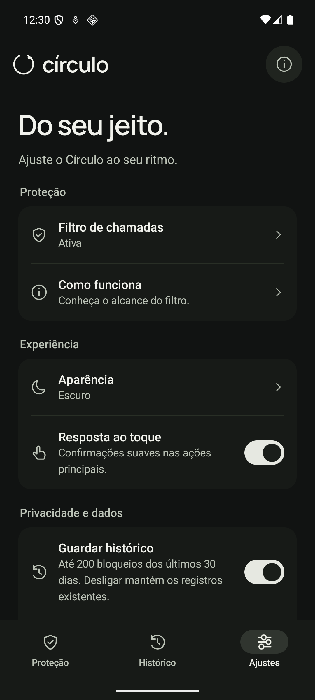

# Círculo

Bloqueie chamadas de números fora da sua agenda. Um app gratuito para Android, feito com Kotlin e Jetpack Compose, sem cadastro e sem internet.

**[Baixar APK v1.1.0](https://github.com/renatomarinhofr/circulo-android/releases/download/v1.1.0/circulo-1.1.0-teste.apk)** · [Todas as versões](https://github.com/renatomarinhofr/circulo-android/releases)

Requer **Android 10 ou superior** e um celular com suporte à identificação e ao bloqueio de chamadas. O APK disponível é uma versão de teste, com assinatura de desenvolvimento.

## Telas

| Proteção | Histórico | Ajustes |
| :---: | :---: | :---: |
|  |  |  |

Prints do emulador Android. O número exibido no histórico é de teste.

## Como funciona

- **Está na agenda:** a chamada toca normalmente.
- **Não está na agenda:** o Círculo rejeita a chamada telefônica identificável quando a proteção está ativa.
- **Está esperando uma entrega ou serviço:** pause por 15 minutos, 1 hora ou 8 horas. A proteção volta ao terminar o prazo.

O Android identifica os contatos; o Círculo não pede acesso à agenda. O histórico é opcional e fica no aparelho, com até 200 bloqueios dos últimos 30 dias. Você pode apagar os registros, salvar um número na agenda e escolher o tema claro ou escuro.

Números ocultos, restritos ou indisponíveis e chamadas de WhatsApp ou outros aplicativos ficam fora deste filtro do Android.

## Instalar e ativar

1. [Baixe o APK](https://github.com/renatomarinhofr/circulo-android/releases/download/v1.1.0/circulo-1.1.0-teste.apk) e abra o arquivo no celular. Se o Android solicitar, permita a instalação pelo navegador ou gerenciador de arquivos usado.
2. Abra o **Círculo**, toque em **Ativar meu círculo** e depois em **Permitir no Android**.
3. Na tela do sistema, escolha o Círculo como app de identificação e bloqueio de chamadas.
4. Confira o indicador **Ativa**.

Se já tem a versão anterior, instale por cima escolhendo **Atualizar**, sem desinstalar.

## Conferir no celular

Use outro telefone para testar:

1. Ligue de um número salvo na agenda: a chamada deve tocar.
2. Ligue de um número fora da agenda: a chamada deve ser rejeitada e aparecer no histórico, se estiver ligado.
3. Toque em **Pausar proteção**: o número fora da agenda deve conseguir tocar. Toque em **Retomar proteção** para voltar a bloquear.


## Compilar

Use JDK 17, Android SDK 36 e Build Tools 36. Configure o SDK no Android Studio ou em `ANDROID_HOME` e execute:

```sh
./gradlew :app:assembleDebug :app:testDebugUnitTest :app:lintDebug
```

O APK fica em `app/build/outputs/apk/debug/app-debug.apk`. Veja [como o filtro funciona](docs/ARQUITETURA.md) e [o que foi verificado](docs/VERIFICACAO.md).

## Licença

[MIT](LICENSE). A fonte Manrope mantém sua [licença SIL Open Font License](licenses/Manrope-OFL.txt).
